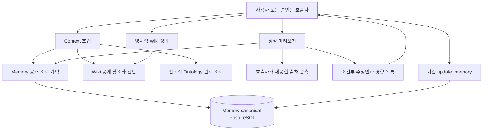

# Ariadne의 근거 기반 기억 구성과 정비 설계

작성: YouSangSon의 요청을 바탕으로 Codex 작성 · 2026-11-09
상태: 상세 설계와 독립 검토 완료. 이 문서의 신규 API·파일·시나리오는 구현 예정이며 현재 기능이 아니다.
기준: `f11ea88` 및 [기억 재사용 구현](memory-reuse.md), [통합 하네스 설계](harness-synthesis-design.md). 요구사항은 [memory-evolution-design](../.harness/reqs/memory-evolution-design.yaml)에서 추적한다.

## 1. 문제와 완료조건

사용자가 원하는 결과는 기억을 더 많이 쌓는 것이 아니라, 원하는 일을 끝낼 때 같은 조사와 잘못된 재사용에 쓰는 비용을 줄이는 것이다. 현재 Memory에는 재확인 설명·보고된 관계·충돌 검사와 정정 영향 조회가 있다. 그러나 설명을 저장하는 것만으로 원문 대조, 필요한 본문 선택, 정정안 검토와 적용이 연결되지는 않는다.

이번 산출물은 다음 여덟 항목을 구현할 수 있는 상세 설계다. 원문 근거 연결, 짧은 안내와 선택 조회, 정정 후보, 실시간 상태와 장기 지식 분리, 과제별 검색/위키 선택, 산출물별 쓰기 소유권, 위키 구조 진단, 제한된 기억 정비를 포함한다. 이번 문서 커밋은 새 런타임을 구현하거나 켜지 않는다. 이전 구현·설계 커밋과 함께 GitHub PR에 반영하며, main 병합은 실제 필수 검사 통과가 조건이다.

완료조건은 입력·출력·권한·소유자·충돌/실패·호환·구현 순서·검증 시나리오가 연결되고 독립 검토의 중대 지적이 해결되는 것이다. 실제 성공률·토큰 절감률·운영 가용성을 입증하는 단계는 별도다.

## 2. 근거와 현재 상태

Anthropic의 [The components of agent memory](https://www.anthropic.com/research/components-of-agent-memory)(2026-11-06, 2026-11-09 확인)는 기록·노트·파생 표현·주입 문맥을 구분하고, 사후 정리의 효과와 비용을 함께 다룬다. 검색과 위키의 결합 이득은 과제에 따라 달랐으며, 과도한 위키와 공유 페이지 덮어쓰기 실패도 보고한다. 이 글의 성과 수치를 Ariadne의 성과로 사용하지 않는다. 아래 설계 선택은 그 사례를 현재 코드에 적용한 제안이며 Anthropic의 보장이나 사용자의 개별 정책 승인으로 기록하지 않는다.

| 현재 소유자/경로 | 확인한 동작 | 이번 설계가 추가할 부분 |
| --- | --- | --- |
| `packages/memory/src/application/tools/tool-handlers.ts` | org 판정 뒤 canonical repository 호출, `inspect_memory_impact`는 같은 scope 관계만 제한 조회 | 안내/선택 조회와 정정 미리보기 |
| `packages/memory/src/infrastructure/postgres/memory-repository.ts` | canonical 저장, 행 잠금과 recordDigest CAS, 재확인 JSONB | v2 근거 위치 보존, 새 조회 projection |
| `packages/memory/src/application/tools/memory-revalidation.ts` | 본문 연결 일치와 외부 현재성 unknown 구분 | 새 출처 관측의 의미를 보존 |
| `modules/context/application.mjs`, `domain.mjs` | 로컬 REQ/handoff/decisions와 선택 스킬을 예산 안에 조립 | Memory 결과를 전달하는 선택적 adapter. 기존 로컬 경로 유지 |
| `modules/llm-wiki/application.mjs`, `files.mjs` | page 쓰기 뒤 log 추가, 링크 관계 snapshot 생성 | 페이지 조건부 게시, 결정론적 링크 진단 |
| `modules/ontology/application.mjs` | 작성된 관계와 source hash freshness | 관계 탐색의 선택적 보조 입력. 사실 판정 소유자 아님 |
| `evaluation/memory-ablation.mjs` | 기억 하나의 포함/제외·고정 과제·비용 비교 | 정비/표현 선택 실험은 별도 fixture로 평가 |

원본 기록은 사용자 발언·모델 추정·도구 관측이 섞일 수 있다. 기록에 있다는 이유로 사실로 승격하지 않는다. 코드 검색·위키 검색·Memory 검색은 서로 다른 정본과 권한을 유지한다.

## 3. 결정과 대안

| ID | 설계 결정 | 근거와 손익 |
| --- | --- | --- |
| ME-D01 | 기존 모듈 소유 기능을 단계적으로 확장 | 사용자의 선택 모듈·DDD/클린 아키텍처 요구 유지. 공통 DB나 새 중앙 지식 정본을 만들지 않음 |
| ME-D02 | 원문 위치·관측값과 사실 판단을 분리 | 출처 hash는 내용 식별값이다. sourceCurrentness와 사실성은 자동 보증하지 않음 |
| ME-D03 | 필수 제약 본문을 보존하고 선택 기억에만 안내 우선 적용 | 작은 문맥의 이점과 중요한 제약 누락 위험을 함께 제어 |
| ME-D04 | 정정 후보는 inert 응답이며 기존 update 경로로 명시 적용 | 새 승인 시스템·정정 event ledger 없이 CAS 재사용. 응답 유실 시 exactly-once 보장 없음 |
| ME-D05 | 초기 정비는 명시 실행·단일 writer·결정론 검사만 | 비용과 작업 중단 위험을 제한. LLM 정비와 주기 실행은 비활성/후속 정책 범위 |
| ME-D06 | 위키는 대상 페이지별 배타적 게시와 expected hash 사용 | 독립 페이지 병렬 준비 가능. 공유 경로의 모든 writer가 계약을 따라야 함 |
| ME-D07 | 전체 비용·품질·누락을 함께 평가 | 조회 빈도, 파일 수, 출력 토큰 감소만으로 효용을 판정하지 않음 |

대안 A는 위 표처럼 owner별 ports에 기능을 붙이고 composition에서 연결한다. 작은 호출 계약과 기존 인증·백업을 재사용한다. 대안 B는 독립 consolidation service와 event ledger가 모든 기억·위키의 상태와 작업을 소유한다. B는 장기 작업 추적에 유리하지만 현재 Task/runtime 설계와 이중 정본이 생기고 교차 저장소 트랜잭션·권한·이벤트 재처리를 먼저 해결해야 한다. 따라서 A를 채택한다. 장기 정비 작업의 관측된 규모와 다중 서비스 운영 요구가 생기면 B의 작업 조정 부분만 재검토하며 원본 소유권은 옮기지 않는다.

구현 순서·숫자 상한은 이 설계의 안전한 초기값이며 부하 실측 결과가 아니다. 현재 조직별 레코드 분포·본문 크기·QPS·SLO는 측정하지 않았다. 이미 존재하는 100/1000 기록, 32KiB metadata 상한을 기반으로 제한 조회를 유지한다. 추정 부하만으로 Kafka/RabbitMQ, Redis, 새 graph DB를 설치하지 않는다.

## 4. 책임과 호출 흐름



Domain은 근거·예산·조건 판정을 소유한다. Application은 인증된 scope와 ports를 조합한다. SQL·파일·HTTP·MCP·프로세스는 adapters에 둔다. Context는 Memory 테이블이나 package 내부 함수를 import하지 않는다. 사용자에게 보이는 조회에는 인증된 organization과 명시 project/user scope를 전달하고, 호출자가 보낸 조직 문자열만 믿지 않는다. 기존 OAuth read/admin 판정을 그대로 적용한다. 기존 scope 체계보다 강한 개인별 ACL을 구현했다고 주장하지 않는다.

Memory만 설치하면 안내·선택 조회·정정 미리보기를 사용할 수 있다. core/ontology만 선택한 설치에는 Memory 접근·DB 연결을 요구하지 않는다. optional adapter가 없으면 unsupported를 반환하고 다른 module의 DB나 로컬 파일을 대체 정본으로 읽지 않는다.

## 5. 출처 관측 모델과 입력 경계

기존 `revalidation.schemaVersion:1`은 변경 없이 읽는다. v2는 같은 JSONB에서 v1 필드에 아래 선택 필드를 더하는 방식으로 계획한다. source row의 기존 `content_hash`는 사용하지 않는다.

```ts
// 설계용 형태. 현재 API가 아님.
type EvidenceAnchor = {
  sourceRef: string;
  sourceDigest: string;             // 전체 원문 snapshot의 SHA-256
  locator: { kind: 'line_range'; start: number; end: number };
  observationKind: 'user_statement' | 'tool_result' | 'model_claim';
  observedAt: string;               // 보고된 ISO8601 시각
};
type RevalidationV2 = RevalidationV1Fields & {
  schemaVersion: 2;
  evidenceAnchors: EvidenceAnchor[];
  reuseClass: 'live_state' | 'derived_knowledge' | 'unspecified';
};
```

최대 anchor 16개, 전체 JSON 32 KiB, ref/id 1,024자, SHA-256 소문자 64자리. line은 양의 안전 정수이며 start<=end다. 첫 버전 locator는 line_range만 지원한다. record ID·PDF 페이지·바이너리 위치는 지원하지 않으며 임의로 line으로 바꾸지 않는다. 시각은 형식만 검사하며 신뢰할 수 있는 서버 시각으로 인증하지 않는다. 문자열에 기존 secret 검사를 적용하고 알 수 없는 key·URL 실행 옵션·shell/argv를 거절한다. `observationKind`는 보고자가 붙인 분류이며 서명이나 사실 인증이 아니다.

v2의 각 anchor는 `sourceObservations` 안의 동일한 `(ref,digest)` 한 쌍을 참조해야 한다. sourceObservations의 동일 쌍과 동일한 anchor(ref/digest/start/end)는 중복 거절한다. 같은 ref의 다른 관측 digest는 별개의 보고된 관측으로 남길 수 있다. 영향 조회의 정본은 기존 sourceObservations이며 anchor만 등록된 출처는 입력에서 거절한다.

v1은 저장된 raw shape와 기존 digest 계산을 유지한다. reuseClass 기본값 등은 읽기 projection에서만 제공하고 JSONB나 recordDigest 입력을 바꾸지 않는다. v2로 명시 교체할 때만 새 필드를 저장한다.

원문 본문을 metadata에 복제하지 않는다. sourceRef는 opaque 값이다. 서버가 URL/파일 경로를 자동 fetch하지 않는다. 최초 단계의 검증 호출자는 권한 있는 별도 경로로 원문을 확보해 제한된 snapshot을 전달한다. 경로 탈출·SSRF를 막기 위해 arbitrary source fetch adapter는 이 단계에 도입하지 않는다. later adapter가 필요하면 allowlist, redirect, byte/time 제한, 자격 증명 소유권을 별도 계약으로 추가한다.

출처 hash가 다르면 locator를 새 원문에 임의 재적용하지 않는다. 없거나 접근 불가이면 unavailable이며 기존 관측을 지우지 않는다. v1 record는 reuseClass unspecified, anchors 없음으로 읽고 기존값을 임의 추론하지 않는다. live_state는 값이 달라졌다는 뜻이 아니라 현재성 확인이 필요한 유형이며, sourceCurrentness는 계속 unknown이다.

## 6. 짧은 안내와 선택 조회

신규 Memory read tool 두 개를 계획한다. HTTP 경로는 각각 `POST /v1/memory/context-index`, `POST /v1/memory/context-resolve`; MCP 이름은 `build_memory_context_index`, `resolve_memory_context`다. 기존 build_context_pack은 호환 유지한다.

### 안내 요청/응답

요청: 명시 scope, 검색 query(1..4,096자), limit(기본 20/최대 100), maxOutputBytes(기본 8,192/최대 65,536). 첫 버전은 canonical repository의 `searchMemory` lexical 경로를 명시한 단일 scope로 호출한다. project+user를 기본 결합하는 `resolveRecords`/`retrieveMemory`는 그대로 재사용하지 않으며 vector/embedding 호출도 시작하지 않는다. hydration까지 org·scope를 SQL 조건으로 대조한다. 기존 랭킹 helper는 후보 범위를 넓히지 않는 범위에서만 재사용한다. 응답 항목은 memoryId, contentDigest, title(최대 256자), reuseClass, binding 상태, sourceCurrentness, 본문 bytes, 선택 이유를 포함한다. 안내용 새 요약을 모델로 생성하지 않는다. title도 untrusted이며 없는 제목은 ID로 표시한다.

응답에 `selectionTruncated`, `candidateCoverage:'retrieval_only'`를 둔다. limit개를 찾았다고 전체 지식이나 관련성을 보장하지 않는다. 조직·scope 밖 정보는 제목·존재·개수에도 포함하지 않는다. bytes는 UTF-8 직렬화 기준이며 토큰 수로 이름 붙이지 않는다.

### 선택 요청/응답

요청: 같은 scope, `{memoryId,contentDigest}` 최대 20개, maxOutputBytes 최대 65,536. 서버가 다시 인증하고 canonical을 같은 scoped query로 읽는다. 하나라도 삭제·scope 불일치이면 식별 대상을 밝히지 않는 unavailable, hash 변경이면 stale_selection을 반환한다. 첫 버전은 요청 집합 전체 성공 또는 실패이며 일부만 성공한 결과를 완전한 pack으로 내보내지 않는다. 오류 응답에도 원문을 포함하지 않는다.

성공 응답은 선택 본문·근거 참조·현재성 상태와 결과 digest다. 예산 초과는 budget_exceeded이며 자동 요약하지 않는다. root Context의 기존 예산 단위는 JavaScript UTF-16 code units이며 Memory의 UTF-8 bytes와 다르다. 두 한도를 유지하고 임의 상수로 환산하지 않는다. Memory 응답 전체의 UTF-8 직렬화 bytes와 root 최종 pack의 UTF-16 길이를 각각 검사하며 메타데이터·scaffold도 포함한다. root adapter는 기존 REQ/decisions/constraints와 명시 선택 스킬을 먼저 보존한 뒤 선택 기억을 조립하고 최종 양쪽 한도를 다시 검사한다. 필수 제약이 넘치면 기존과 같이 오류다. 안내→선택 사이 변경은 재선택해야 하며 모델이 이미 읽은 옛 문맥을 제거했다고 주장하지 않는다.

고정된 안내를 매 세션 무조건 주입하지 않는다. 현재 요청의 범위와 명시적 선택이 있을 때만 포함하며 다른 세션의 권한·현재성 결과를 캐시하지 않는다. MSA 전환 시에도 이 공개 DTO와 재인증 책임을 유지한다.

## 7. 정정 후보와 명시 적용

신규 admin tool `preview_memory_correction`, HTTP `POST /v1/memory/correction-preview`를 계획한다. 미리보기도 기존값을 읽고 수정 제안을 다루므로 기존 update의 admin 범위를 요구한다.

입력은 명시 scope, memoryId, expectedRecordDigest, proposedChanges(기존 update가 지원하는 body/summary/title/kind), 선택적인 replacementRevalidation, 제한된 sourceSnapshots다. snapshot은 ref, UTF-8 text, digest로 구성하며 최대 4개·각 64 KiB·합계 256 KiB다. 서버는 digest와 bytes/secret 제한을 검사한다. snapshot digest는 정규화하지 않은 text의 UTF-8 bytes로 계산한다. locator는 1부터 시작하는 LF 구분 line이며 CRLF의 CR은 표시용 끝문자로만 제거한다. 빈 마지막 line도 구분하며 범위를 벗어나면 invalid_locator다. line 대조는 해당 위치의 텍스트를 찾았다는 뜻이며 주장 지지 판정이 아니다. 허용되지 않는 record_id locator는 입력 오류다. 외부 fetch나 LLM 호출은 없다. 현재 body와 제안 body를 의미적으로 비교해 진위를 판정하지 않는다.

출력은 before/after contentDigest, expectedRecordDigest, 보고된 변경 이유, source별 `matching_snapshot|digest_mismatch|unavailable`, 미검증 의미 항목, 현재 등록된 영향 조회 결과, 정확한 `update_memory` request를 담는다. 하나라도 supplied snapshot의 digest가 잘못되면 입력 오류이며 후보를 생성하지 않는다. 출처가 충분한지 여부는 caller 판단 대상이고 verified 플래그를 반환하지 않는다.

새 본문에 기존 recipe를 조용히 재연결하지 않는다. replacementRevalidation이 없으면 예전 연결을 보존하여 mismatch가 드러난다. 명시 교체를 받으면 prospective body의 digest로 binding을 검증한다. 연결이 맞는 것과 주장이 참인 것은 다르다.

미리보기는 DB를 쓰지 않는다. 응답의 `proposalDigest`는 scope·before/after·source hashes·정확한 patch를 정규 직렬화한 SHA-256이며 인증 토큰이 아니다. caller가 artifact를 저장할 경우 자기 저장소의 권한/보존 책임을 따른다. 신규 proposal 테이블·승인 daemon은 만들지 않는다.

적용은 사용자가 확인한 요청 또는 이미 그 효과를 승인받은 호출자가 기존 update_memory를 호출한다. 서버가 admin/org를 다시 판정하고 기존 row-lock CAS로 원자적으로 수정한다. 미리보기 후 동시 수정이면409이고 자동 재기반하지 않는다. 성공 응답 유실 시 최신 record를 다시 읽어 비교하되, 같다는 이유만으로 본 호출이 성공했다고 단정하지 않는다. 확인 불가능하면 unknown으로 남긴다. 외부 source의 관측 이후 변화까지 DB transaction으로 잠글 수 없으므로 sourceCurrentness는 unknown을 유지한다.

## 8. 표현 선택과 위키 게시

첫 버전은 자동 task classifier 대신 호출자의 `representation: search|wiki|combined`를 사용한다. 기본은 search다. combined는 검색을 원문 확인 경로로 유지하고 위키를 안내로 사용한다. wiki-only도 원문 접근 실패·출처 연결 누락을 숨기지 않는다. Ontology 결과는 관계 후보와 freshness로만 제공하고 정답 판정에 사용하지 않는다.

`Ariadne knowledge inspect --vault <vault> --project <project>`는 실제 저장 위치인 `<vault>/Projects/<project>/Long/llm-wiki` 안의 기존 Wiki 문서를 읽어 missing_target, isolated_page, duplicate_candidate를 보고한다. 최대 1,000페이지·페이지 1 MiB·총 16 MiB·edge 10,000개의 초기 상한, 초과시 truncated. duplicate_candidate는 동일 내용 hash에 한정한다. 의미상 유사성 병합은 하지 않는다. 현재 unresolved 렌더링은 재사용하되 snapshot 시각/hash를 명시한다. 기존 `readGraph`의 vault 전체 basename 열거는 새 경로에서 사용하지 않는다. 호출자가 승인한 해당 project namespace 안의 정규화된 상대 경로로만 대조한다. 다른 프로젝트·외부 문서·앵커 미검증은 external_or_unchecked, basename 중복은 ambiguous로 표시하며 missing_target으로 단정하지 않는다. root REQ를 읽는 source root와 wiki를 쓰는 vault root는 각각 명시하고 별도로 confinement을 검증한다. Memory org 권한은 vault 파일 접근 권한을 부여하지 않는다.

Wiki 변경은 문서별 준비→대상 hash 대조→단일 게시 순서다. 기존 `promote`와 `index`도 같은 게시 adapter를 사용하도록 전환해야 보장하며, 별도의 새 명령에만 lock을 추가하지 않는다. project 값은 단일 이름으로 검증해 `/`, `\`, `..` 및 빈 값을 거절한다. 사용자 수정 페이지는 expected hash가 다르면 conflict다. 파일 adapter는 root confinement, symlink 거절, 같은 filesystem의 exclusive 임시파일과 atomic rename을 사용한다. 그 앞에서 프로젝트별 lock을 배타 생성해 참여 writer를 직렬화한다. lock은 자동 만료·탈취하지 않으며 충돌은 busy로 반환한다. crash로 남은 lock은 실행 종료를 확인한 운영자가 해제한다. 비참여 외부 편집기와의 원자 CAS는 보장하지 않으므로 관리 대상 페이지를 구분하며 외부 동시 편집이 필요한 배포는 owner service의 원자 CAS가 선행 조건이다.

현재 page 쓰기와 log 추가는 단일 transaction이 아니다. 새 게시도 두 파일 전체 원자성을 주장하지 않는다. page가 정본이고 log/index는 파생물이다. 새로 관리하는 page에는 rendererVersion, source snapshot hashes, renderDate, 본문 payloadHash를 담은 제한된 관리 header를 기록한다. 게시 identity는 이 값과 상대 page path로 계산하며 header 자체를 포함한 순환 hash는 만들지 않는다. 관리 header는 사실 인증이 아니며 사용자 수정 여부를 expected file hash로 별도 판정한다. page 성공·log 실패는 `published_with_pending_index`로 보고하고 동일 page hash의 명시 재실행에서도 log/index 복구를 수행한다. 기존 appendLog의 changed 조건을 이 새 경로에 재사용하지 않는다. 프로젝트 lock 아래 현재 관리 page headers로 결정론 log block을 생성해 기존 log.md의 관리 marker 구간만 원자 교체한다. block 밖의 과거 기록·사용자 문장은 보존한다. 관리 marker가 훼손됐으면 자동 복구하지 않고 pending으로 보고한다. 동일 identity는 block 안에 하나만 두므로 partial append와 중복을 피한다. graph index도 관리 page/source 집합에서 재생성한다. log·graphs·lock·임시 파일은 원문 열거에서 제외하여 파생물이 자신을 계속 재수집하지 않게 한다. 게시 전 실패는 기존page보존. source hash 변경·취소 시 미게시 임시파일을 제거한다. 여러 페이지 전체 성공은 보장하지 않고 결과를 page별로 반환한다.

## 9. 비용이 제한된 정비와 자원 수명

초기 `Ariadne knowledge maintain --plan <file>`는 호출자가 승인한 source root·vault·project와 고정된 입력 목록을 받아 preview를 만든다. 자동 타이머와 watcher가 없고 보고된 실패만으로 실행하지 않는다. 입력 manifest는 schemaVersion=1, project, sourceRoot/vault 식별값, operation 목록, maxPages<=100, maxBytes<=16MiB, maxDurationMs<=30000을 명시한다. 이 숫자는 초기 상한이며 처리량 보장이 아니다.

허용 operation은 `rebuild_index`와 `publish_promotion` 두 개다. 전자는 범위 안 페이지로 기존 graph renderer를 호출하고, 후자는 명시 source root의 REQ/decisions/handoff로 기존 promotion renderer를 호출한다. 임의 patch·link 치환·파일 삭제·의미 병합은 허용하지 않는다. missing link는 진단과 수동 수정 후보로만 남긴다. 입력 자료 전체가 상한 안에 없으면 해당 게시 operation은 blocked이고 일부 snapshot으로 완전한 index를 덮어쓰지 않는다.

preview plan은 rendererVersion, 고정 renderDate, 승인된 root/project, 모든 입력의 상대 경로·hash, target별 expectedHash(없는 파일은 null)·정확한 outputHash·operation·상한을 포함한다. planDigest는 정규 JSON 전체를 식별한다. 기본 동작은 이 inert 계획을 출력하는 것이다. 적용은 `--apply --expected-plan-sha256 <digest>`로 정확한 계획의 파일 변경을 승인한 호출에서만 가능하다. digest는 권한 토큰이 아니고 계획 동일성 검사다.

apply는 크기/경로/operation/schema를 다시 검증하고, lock을 잡은 뒤 입력 목록·내용·대상 hash를 재대조한다. 파일 추가·삭제로 입력 집합이 바뀌어도 conflict다. 고정 renderDate와 rendererVersion으로 다시 렌더링한 outputHash가 다르면 재계획해야 한다. 같은 출력이 이미 있으면 쓰지 않고 필요한 log/index 상태만 확인한다. 다른 target은 독립 결과로 반환하며 한 번 승인한 계획의 변경분을 자동 확대하지 않는다. source root와 vault는 서로 다른 파일시스템일 수 있어 외부 편집기를 동시에 잠글 수 없다. 게시 결과에는 사용한 source snapshot을 남기며 그 이후 원본의 최신성은 주장하지 않는다.

arbitrary shell/tool/LLM은 manifest에 넣을 수 없다. LLM 정비는 공급자·모델·토큰/비용 상한·취소와 과금 귀속을 합의할 때 별도 version으로 설계한다. 현재 실행 승인과 유료 모델 사용 승인을 혼동하지 않는다.

현재 sync recursive 파일 열거/쓰기 경로는 그대로 두고 AbortSignal만 붙이지 않는다. 새 경로는 bounded iterator와 페이지 사이 비동기 yield/checkpoint를 사용하고, 읽기/게시 직전 monotonic deadline과 취소 상태를 검사한다. 작업 owner가 AbortSignal, file handles, lock, tempfiles를 소유한다. 진행 중인 filesystem syscall이 deadline에 강제 중단된다고 보장하지 않으며 실제 반환/종료를 기다린 뒤 결과를 보고한다. timeout/취소는 새 읽기·게시 시작을 막고 진행 중 atomic publish의 결과를 확인한 뒤 종료한다. 정리를 호출했다는 사실만으로 종료 완료로 보고하지 않는다. 실패한 정리 경로를 보고하고 다른 작업의 lock·공유 캐시를 삭제하지 않는다. 입력이 바뀐 재시도는 새 계획이며 이전 성공 페이지를 무조건 다시 쓰지 않는다.

비용 보고는 실제 관측한 wall time, files/bytes 읽기·쓰기, model usage(not_used 또는 unknown)를 구분한다. 언어를 바꾸거나 백그라운드로 옮겨도 모델 토큰이 자동 감소하지 않는다. 성공한 사용자 과제의 결과·실패/재시도·기억 생성/정비 비용을 함께 비교한다.

## 10. 검증 시나리오

아래는 설계된 기대값이며 신규 테스트는 아직 작성/실행하지 않았다. 기존 MR 시나리오는 [memory-reuse](memory-reuse.md)에서 보존한다.

| ID / 결정 | 조건과 행동 | 기대 결과·금지 결과 | 검증 계층 |
| --- | --- | --- | --- |
| ME-S01 / D02 | snapshot hash 일치, 모델 발언을 출처로 제시 | 위치는 대조 가능, observationKind=model_claim과 사실 미검증 유지 | 단위/API |
| ME-S02 / D02 | source hash 변경·locator 범위 오류·ref 비밀 포함 | 바뀐 원문에 옛 위치 재적용 금지, 잘못된 입력 거절 | 단위/API |
| ME-S03 / D03 | 안내 뒤 본문 수정·삭제, 다른 org 또는 같은 org의 다른 project/user scope로 index/resolve | stale/unavailable, 본문·다른 조직·scope의 존재 정보·개수·제목 노출 금지 | PG/API |
| ME-S04 / D03 | 선택 기억보다 필수 제약이 큼 | 필수 제약 삭제 금지, budget_exceeded | Context 계약 |
| ME-S05 / D04 | preview 후 다른 writer metadata만 수정 | 기존 CAS 409, 새 내용으로 자동 재기반 금지 | Podman PG 동시성 |
| ME-S06 / D04 | body변경에 replacementrecipe 없음 | 이전 연결 보존/mismatch, 자동 인증 금지 | PG/Context |
| ME-S07 / D04 | apply응답 유실·source가 관측후 변경 | 상태 재조회/unknown, exactly-once나 외부 최신성 주장 금지 | API 장애주입 |
| ME-S08 / D01 | Memory미설치, core/ontology만 선택 | 로컬 경로 작동, DB자동연결·내부 import 금지 | 설치/아키텍처 |
| ME-S09 / D06 | 두 writer가 같은pagehash로 게시 | lock 참여 writer 한명만 게시, 다른 요청 busy/conflict | 파일 프로세스 통합 |
| ME-S10 / D06 | page게시후log 실패 또는 중간취소 | page보존, pending상태, 명시재시도에서 파생물만 복구 | 파일 장애주입 |
| ME-S11 / D05 | 상한초과·missinglink·외부경로/symlink | truncated/invalid, 임의fetch·임의병합 없음 | 단위/파일 |
| ME-S12 / D05 | 정비timeout과게시경합·crashlock | 게시결과 확인, 소유temp정리, 남은lock보고, 자동탈취없음 | 프로세스 통합 |
| ME-S13 / D07 | search/wiki/combined 조건 비교 | 고정자료·동일과제·모델·verifier, 구축비포함, 누락unknown | 오프라인 평가 |
| ME-S15 / D05·06 | preview 후 입력 추가·수정, renderer 변경 또는 plan 변조 | expected plan digest와 source/target 집합 재검증, conflict 시 게시 금지 | 파일 계약 |
| ME-S16 / D01·06 | 다른 project에 같은 basename, 외부 link, project 경로 탈출 | ambiguous/external_or_unchecked 구분, vault 전체 노출·범위 밖 쓰기 금지 | 파일 보안 |
| ME-S17 / D02 | anchor-only 출처·중복관측·CRLF/빈마지막line·locator 초과 | ref/digest 정합성 및 정확한 line 규칙, 영향 누락·사실 인증 금지 | 단위/API |
| ME-S18 / D03 | 한글·이모지·scaffold로 bytes/code units 차이 | 각 최종 직렬화 한도 개별 검사, 잘못된 환산이나 필수 제약 잘림 금지 | Context 계약 |
| ME-S14 / D01·02 | v1 구버전 reader와 v2 행 공존 | reader 배포 선행, v1 raw shape/digest 보존, 구버전으로 무조건 rollback 금지 | migration/혼합버전 |

실제 모델 실험은 고정된 독립 과제 세트에서 검색으로 충분한 과제, 복수 자료 결합, 정정/반례, 권한 거절을 포함한다. 기존 memory-ablation은 단일 기억 비교용으로 유지하며 세 표현을 v1 두 variant에 섞지 않는다. 우선 search 대 combined의 별도 고정된 두 조건 비교를 기존 eval compare로 수행한다. 모든 비용을 수집하지 못하면 순절감 주장은 보류한다.

## 11. 구현 단위와 파일 영향

기존 파일은 확인된 경로이며 `(신규)`는 구현 예정이다. 실제 추가 시 architecture-map과 공개 도구 목록/문서 drift 검사도 같이 갱신한다.

| 단계 | 파일 | 변경과 완료조건 |
| --- | --- | --- |
| A 근거 | `packages/memory/src/domain/policies/memory-revalidation.ts`, `src/domain/model/memory.ts`, `src/application/tools/memory-revalidation.ts` | v1/v2 판별·anchor 검증·derived state. ME-S01/02 |
| A 저장 | `packages/memory/src/infrastructure/postgres/memory-repository.ts`, `memory-archive-repository.ts` | v2 보존/restore, canonical digest 유지. 새 column 불필요. ME-S14 |
| B 조회 | `packages/memory/src/application/ports/memory-repositories.ts`, `src/application/tools/memory-context.ts`(신규), `tool-handlers.ts` | scoped candidate projection/resolve, 예산/불일치. ME-S03/04 |
| B 조립 | `modules/context/application.mjs`, `domain.mjs`, `memory-adapter.mjs`(신규), `lib/context-pack.mjs` | 공개 응답 DTO조립, optional Memory 연결. credentials는 runtime입력이며 pack에 포함금지. ME-S08 |
| C 정정 | `packages/memory/src/application/tools/memory-correction.ts`(신규), `tool-handlers.ts`, `contracts/tools.ts` | inert preview와 정확한 기존 update request. ME-S05/06/07 |
| A~C 전송 | `packages/memory/src/interfaces/mcp/tool-schemas.ts`, `src/interfaces/http/middleware/mcp-http-auth.ts`, `oauth-token-auth.ts`, `src/application/tools/tool-registry-instrumentation.ts` | strict입출력·OAuth·등록·감사. API요청상한과현재handler연결 |
| D Wiki | `modules/llm-wiki/domain.mjs`, `application.mjs`, `files.mjs`, `promote.mjs`, `graph-index.mjs`, `inspect.mjs`(신규), `maintain.mjs`(신규), `core/domain/product.mjs`, `bin/Ariadne.mjs` | 진단·manifest·배타게시·취소·repair. ME-S09~12 |
| E 평가 | `evaluation/README.md`, `evaluation/memory-evolution-fixtures.json`(신규) | 고정된 task/조건/실패/비용 fixture. ME-S13 |
| 검사 | `packages/memory/tests/revalidation/`, `tests/store/memory-repository.test.ts`, `tests/app/server.test.ts`, `tests/mcp/server.test.ts`; root `tests/memory-context.test.mjs`, `tests/wiki-maintenance.test.mjs`(신규) | 단위/API/PG/파일실패검사, 공개schema·권한·수명주기 |
| 문서/등록 | root와Memory의 `architecture-map.json`, root4언어README, `packages/memory/CONTRACTS.md`, `docs/api-reference.md`, `docs/api-reference.ko.md`, `modules/llm-wiki/README.md`, 본문서 | 현재/계획 구분, route/count drift회귀와사용법동기화 |

A~C가 Memory 계약의 첫 전달 단위다. D는 독립 Wiki 단위이며 A~C가 없어도 명시 파일 진단이 가능하다. E에서 효용이 확인되기 전 자동 실행·기본 주입으로 승격하지 않는다. 언어 재작성·새 DB·인증 교체는 선행 조건이 아니다.

## 12. 전환·롤백·MSA 조건

현재 v1 JSONB는 그대로 유지한다. 먼저 모든 reader와 archive/restore writer가 v1/v2를 이해하도록 배포하고, 그 전에는 v2 쓰기를 허용하지 않는다. v2 쓰기는 운영자가 명시 활성화한다. 형식 전환 backfill은 불필요하다. 구버전 reader는 v2를 거절할 수 있으므로 v2가 존재한 뒤 구버전 binary로 즉시 rollback하지 않는다. v2 쓰기만 비활성화하고 호환 reader를 유지하는 rollback을 우선한다. v2 정보를 버리는 역변환은 별도 승인·백업이 필요하다.

선택 조회와 미리보기는 읽기 경로이며 추가 테이블이 없다. 동기 source fetch가 없으므로 외부 장애가 Memory DB transaction을 붙잡지 않는다. Wiki 파일 게시와 Memory 수정은 분산 원자성을 보장하지 않으며 각 owner의 결과를 독립 보고한다.

MSA로 분리할 때 인증된 principal/org/scope, DTO version, timeout/cancellation과 결과 unknown을 유지한다. owner 밖에서 SQL을 공유하지 않는다. 첫 원격 adapter는 공개 HTTP를 사용한다. Kafka/RabbitMQ 도입은 장기 정비의 유입량·복구 요건이 관측될 때 결정하고, broker의 중복 전달만으로 메모리 수정을 재실행하지 않는다. 현재 설계에는 분산 lease·자동 재시작·백그라운드 정비가 없다.

## 13. 언어 선택과 Rust 적용 가능성

이 기억 설계 당시의 Rust/다른 언어 질문은 가능성과 전환 범위 검토였다. 이후 사용자가 Go+Rust 조합의 설계를 요청하여 [별도 전환 설계](go-rust-runtime-design.ko.md)로 구체화했다. 아래 비교는 당시 판단 근거이며, 언어 전환 목표와 순서의 정본은 후속 문서다. 재작성 구현 승인은 두 설계에 포함되지 않는다. 현재 JS/TS의 `@modelcontextprotocol/sdk`, Zod DTO, Node SQLite와 `sqlite-vec`, transformer runtime, PostgreSQL adapters 및 CLI/import 계약을 교체하는 비용이 있다. Rust MCP SDK와 Go SDK는 공식 프로젝트에 존재하지만 현재 기능과의 동등성은 별도 계약 검사가 필요하다([Rust SDK](https://github.com/modelcontextprotocol/rust-sdk), [Go SDK](https://github.com/modelcontextprotocol/go-sdk), 2026-11-09 확인).

| 선택 | 적합한 범위 | 비용/한계 |
| --- | --- | --- |
| JS/TS 유지 | 현재 전송·오케스트레이션·모델 adapter·기존 export | 재작성 비용 최소. 현재 CPU/RSS/시작 지연 병목은 미측정 |
| Rust 모듈 | 측정된 CPU 중심 색인·파싱·대량 graph 처리, 독립 CLI 배포 | parser/SQLite/vector 동등성·빌드 대상·FFI 또는 IPC·오류/취소 계약을 새로 검증 |
| Go 서비스 | Memory HTTP 서비스나 명시 worker의 독립 운영이 필요할 때 | 저장/인증/SDK 동등성 비용. 모델 토큰 감소를 보장하지 않음 |
| Python 보조 | 연구·오프라인 평가 기법 실험 | 기존 제품 runtime 교체의 근거는 부족하고 배포 환경이 하나 추가됨 |

권고는 지금 전면 재작성하지 않고 언어 독립 DTO와 owner 경계를 유지하는 것이다. 먼저 고정 workload에서 cold start·CPU·RSS·p95 처리시간·결과 동등성을 측정한다. 병목이 실제로 로컬 계산에 있으면 Code의 순수 계산 단위 하나를 Rust subprocess로 실험한다. 제한된 JSON stdin/stdout, timeout, 종료 대기, 오류 분류를 고정하고 기존 TS 구현을 비교 기준으로 남긴다. 공개 JS import를 제거하거나 기존 DB를 동시에 쓰지 않는다. 시험 대상과 수치 목표는 측정 후 결정하며 이번 설계의 필수 구현 범위가 아니다.

## 14. 문서 검증과 남은 실행

설계 검증은 기존 호출 경로 대조, 대안 비교, 시나리오/결정 연결, 독립 리뷰, Markdown 링크/REQ 검사로 수행한다. 신규 기능 테스트는 구현 단계에서 앞의 시나리오로 작성한다. 기존 커밋 병합의 필수 CI는 현재 PR HEAD에서 별도로 확인한다. 테스트 통과·설계 완료·main 병합·운영 배포는 각각 다른 상태다.

설계 검토 결과: 독립 검토에서 발견한 7개 중대 공백을 §5–9와 ME-S03/15–18에 반영했고 재검토에서 남은 Blocker/Major는 없었다. 루트 source·mirror·REQ 검사를 통과했다. 이는 문서와 기존 코드의 계약 대조 결과이며 신규 기능의 구현·동작 검증 완료가 아니다.
